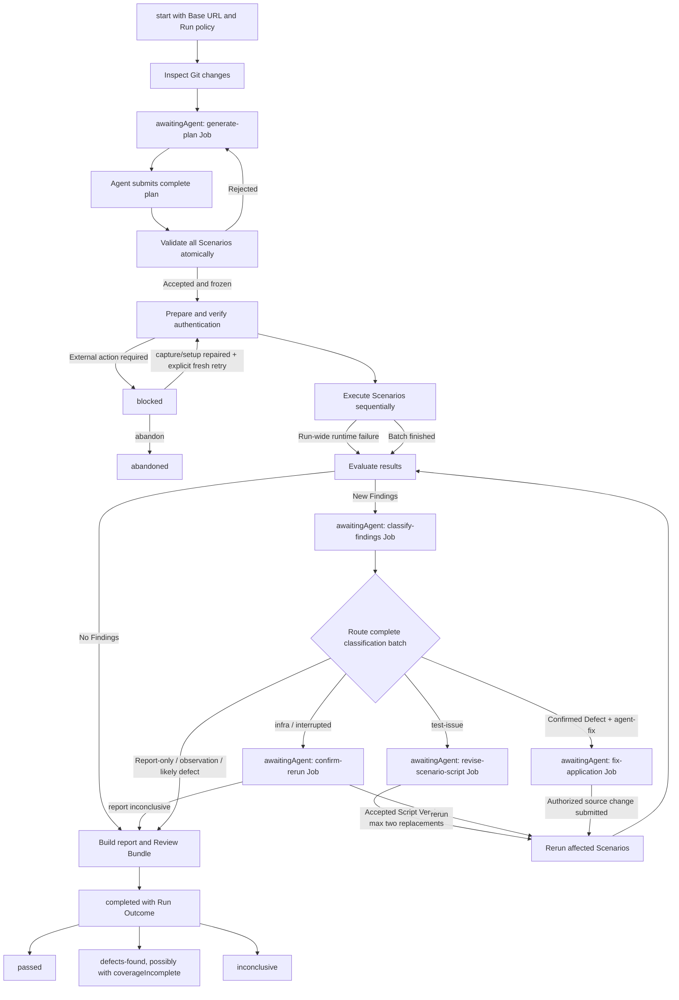
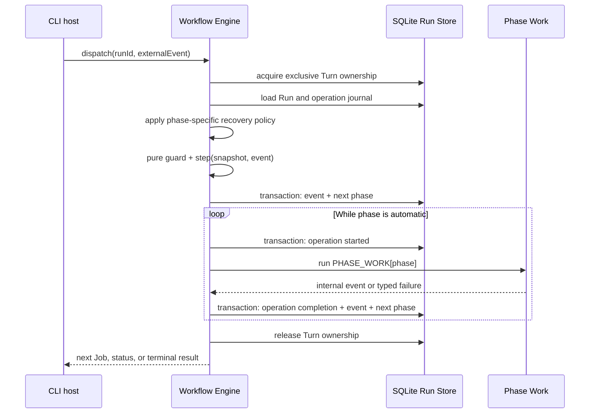
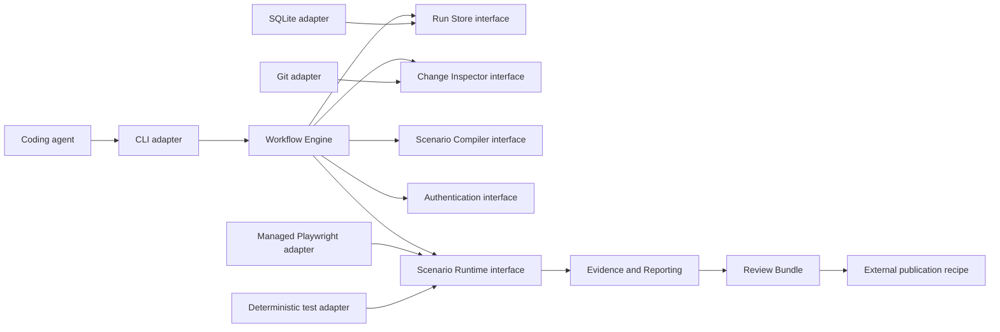

# Auto-QA System Overview

Auto-QA is an agent-neutral local CLI that turns frontend QA into a durable conversation between a coding agent and a real browser. The coding agent supplies judgment and application knowledge through Jobs; Auto-QA owns ordering, validation, browser execution, evidence, recovery, and enforcement.

## End-to-end workflow



`awaitingAgent` is the sole ordinary agent Input Boundary. The pending Job—not the phase name—defines the requested response and its schema.

Completed Runs are immutable. Verification after completion creates a new Run.

## One crash-consistent Turn



No external work begins before its `started` operation exists. SQLite transactions are short and never remain open during Playwright execution.

Recovery is phase-specific:

- deterministic work may rerun;
- interrupted Scenario execution becomes a Finding and never reruns silently;
- interrupted application-owned Auth Setup blocks; Auto-QA never resumes or
  silently retries it. The external choice is a fresh Auth Setup operation or
  Run abandonment.

`job` and `status` are concurrent read-only observations of the last committed state. They never acquire Turn ownership or trigger recovery. A competing mutating command receives `RUN_BUSY`.

## Major modules and interfaces



### Workflow Engine

The host-neutral public interface remains intentionally small:

```ts
interface WorkflowEngine {
  dispatch(
    runId: RunId,
    event: ExternalEvent,
  ): Effect.Effect<DispatchResult, WorkflowError>

  getPendingJob(
    runId: RunId,
  ): Effect.Effect<Job | null, WorkflowError>

  getStatus(
    runId: RunId,
  ): Effect.Effect<RunStatus, WorkflowError>
}
```

The engine owns the transition table, pure guards, `step`, automatic Turn loop, Job routing, recovery policies, and Run invariants. It knows nothing about Commander, argv, stdout, or a particular coding agent.

### Run Store

The Run Store provides versioned reads, short atomic mutations, operation journaling, idempotent Job completion, and exclusive Turn ownership. Its SQLite adapter stores Runs, events, Jobs, operations, Scenarios, numbered Scenario Scripts, Attempts, Findings, classifications, and evidence references in `.auto-qa/state.db`.

The interface exposes domain operations rather than SQL or generic table access. SQLite uses WAL mode so read-only status remains available during browser work. A per-Run lock or lease owns the full Turn beyond the duration of any database transaction.

### Change Inspector

The Change Inspector returns capped Git context and a worktree fingerprint. It supports unusual but valid repositories such as unborn branches and detached HEAD. Unexpected fingerprint drift blocks the Run unless a pending `fix-application` Job explicitly authorizes source changes.

### Scenario Compiler

The Scenario Compiler validates the plan atomically, lints trusted Playwright scripts, enforces configured budgets, and freezes accepted script bytes. It rejects unsafe reliability patterns with actionable errors. The initial accepted source becomes Scenario Script Version 0; accepted post-execution replacements create Versions 1 and 2, while rejected submissions consume no replacement allowance. Every Attempt records the exact frozen Script Version it executed.

### Authentication

Authentication has two preparation paths behind one resulting authenticated-context contract:

- local interactive capture creates a reusable, exact-origin-bound Auth Profile;
- application-owned Auth Setup creates fresh state for unattended execution.

A project-owned verifier from `auto-qa.config.ts` independently verifies either path. Auto-QA stores no credentials and never prints authentication state.

### Scenario Runtime

The workflow crosses one browser seam:

```ts
interface ScenarioRuntime {
  execute(
    attempt: FrozenScenarioAttempt,
    environment: ScenarioEnvironment,
  ): Effect.Effect<AttemptResult, ScenarioRuntimeError>
}
```

The interface hides browser objects, processes, scopes, and artifact mechanics. V1 supplies directly managed Playwright plus a deterministic test adapter. Browser Control or another transport may be added later only if it can satisfy the same Attempt contract.

Scenarios execute sequentially. Ordinary assertion, script, and timeout failures do not stop the batch; typed run-wide auth, target, or browser failures do.

### Evidence and reporting

Each Attempt produces an Evidence Bundle. Each completed Run produces a report and curated Review Bundle. Raw traces are treated as sensitive; Auth Profiles are always separate. Auto-QA never publishes directly in v1. A first-party GitHub Actions recipe uploads artifacts, writes a Job Summary, and links the PR to the review material.

## Persistence and files

```text
.auto-qa/
├── state.db
├── locks/
├── registry.json
├── auth/
│   └── <profile>.json
└── runs/
    └── <run-id>/
        ├── report.md
        ├── review-bundle/
        └── scenarios/
            └── <scenario-id>/
                └── attempt-<n>/
                    ├── trace.zip
                    ├── video.webm
                    ├── screenshots/
                    ├── console.jsonl
                    ├── network.jsonl
                    ├── actions.jsonl
                    └── result.json
```

`cleanup` reconciles only registered runtime resources and stale locks. Run Retention manages disk usage through `runs storage`, `runs expire`, and `runs keep`; it never expires active, blocked, or Kept Runs.

## Run policies

A Run persists the choices that affect enforcement:

- Base URL;
- local or CI Mode;
- `report-only` or `agent-fix` Remediation Policy;
- whether Mutating Scenarios are permitted;
- authentication selection;
- effective Scenario count and execution budgets;
- evidence defaults.

These policies cannot silently change midway through a Run.

## V1 boundaries

V1 does not include a daemon, MCP server, autonomous model provider, agentless end-to-end CI orchestration, promoted durable test suite, dev-server discovery, hosted evidence service, or existing-browser integration. CI Mode remains agent-driven. The surrounding CI workflow decides whether Auto-QA's honest nonzero outcome blocks merging.

## Intentionally open implementation experiments

Two questions remain open without changing the architecture:

1. Whether long Turns should emit one final stdout JSON document with stderr progress, JSON Lines events, or opt-in progress.
2. The numerical zero-configuration defaults for Scenario count and execution budgets.

Both are tracked in [open-questions.md](./open-questions.md) and should be tested against the walking skeleton before being fixed.

The behavioral seams, failure matrices, crash harness, and CI tiers are defined
in [testing-strategy.md](./testing-strategy.md). Every implementation slice is
delivered through test-driven tracer bullets at those seams.
